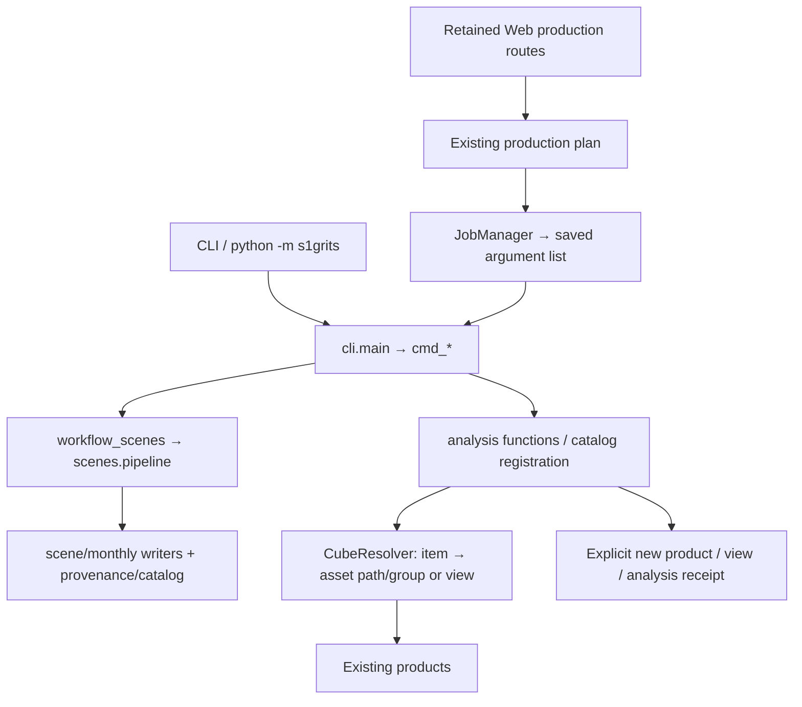

# Runtime call paths / 功能调用关系

This map describes the V4 implementation. Commands, defaults and support limits
remain in [entry points](entry_points.md); this page identifies the code owners.
The new tools use CLI/Python. The existing Chinese Web and its bounded job queue
are retained; new Web integrations are deferred to `feature/web-console-v4`.
This does not introduce a distributed scheduler or a second algorithm engine.

Web uses argument lists with `shell=False`, not generated shell programs.
Read-only catalog queries go directly to `webapp.catalog_api.Workspace`;
existing production tasks use the queue and CLI handlers. This does not expose
all new CLI handlers through Web. Python callers can invoke the analysis functions directly.

| Operation / 操作 | Entry → implementation / 入口与实现 | Result / 输出 |
| --- | --- | --- |
| New/resumed scenes and monthly production | `cmd_process_scenes` → `workflow_scenes.run_scenes_workflow` → `scenes.pipeline` → scene/monthly writers | Scenes/monthly stores, catalog and configured provenance; optional static post-stage |
| Filters, features, monthly derivatives and interpolation | `cmd_derive_cube` → `analysis.derive.derive_cube` → `cube_ops` / `interpolation` | New product plus derivation receipt; parent read-only |
| Selection/feature views | `cmd_view` → `views.define_view` + `register_view` | Definition and registered reference, no imagery copy |
| Multi-track monthly view | `cmd_view` → `multitrack.define_multitrack_view` → `views.register_view` | Ordered parent references and explicit combination method |
| Materialization | `cmd_view` → `views.materialize_view` | Explicit new physical product; shared block writers |
| Product registration | `cmd_catalog_register` → `catalog_registration.register_product` | Catalog/registration records pointing to existing assets |
| CUSUM | `cmd_analyze_cusum` → `analysis.cusum.analyze_cusum` → separately installed nrt | Independent analysis maps and receipt; no Web endpoint |
| LandTrendr / explicit GEE point segmentation | `cmd_analyze_segments` → `analysis.segmentation.analyze_segments` | Point analysis files; explicit backend |
| Local LandTrendr point set/window | `cmd_analyze_segments_batch` → `segmentation_batch.analyze_segments_batch` | Per-point status and batch receipt |
| Inter-tile mosaic | `cmd_mosaic_grid` → `analysis.mosaic` | VRT/COG and receipt from explicitly selected inputs |

三个镶嵌操作分属不同层：同次获取的 burst 策略在生产 `scenes` 路径；多轨月度组合
在 `analysis.multitrack`；邻格 VRT／COG 在 `analysis.mosaic`。它们不互相替代。
新增策略只通过相应参数显式启用，不绕过现有生产分组或写入流程。

`CubeResolver` 负责确定实例、资产与 group。读取虚拟实例时按需导入
`analysis.views.open_view`；view 再读取其父资产。这个按需读取关系不应误解为
重新运行生产。派生和物化复用现有 block writer／回滚辅助函数，
因此修改 writer 时应一起运行对应派生、视图与生产测试。

新增工具的 Web 参数映射、预检查及结果读取保存在 `feature/web-console-v4`，
本次候选不包含这些接入。修改科学参数时核对 CLI、Python 实现及原生 receipt；
后续 Web 接入复用这些实现，不另建计算逻辑。

Regression tests live in `tests/`; runtime modules do not import tests, tools
or benchmarks. See [test/artifact placement](../tests/README.md). The practical
cross-entry checks are `test_onboarding`, `test_skill_replay`,
`test_multitrack_views`, `test_resolver_selection` and
`test_workflow_scenes_monthly_only`. No new dispatcher or abstraction is needed.
